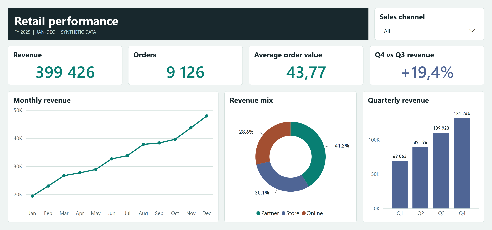

# Power BI Local MCP

Describe a dashboard in plain language. An MCP client uses this local server to bind existing measures and columns to Power BI visuals. The server creates a validated **new project copy** without opening Power BI Desktop or changing the source.

## Quick start: Build a dashboard with Codex

These steps use Windows PowerShell. You need **Git**, **Node.js 22 or newer**, and the **Codex CLI** on your PATH. Power BI Desktop is only needed to open and interact with the finished report.

### 1. Install and create the sample project

```powershell
git clone https://github.com/togrulh/powerbi-local-mcp.git
cd powerbi-local-mcp
npm.cmd ci
npm.cmd run demo
```

This creates `workspace/RetailDemo/RetailDemo.pbip` with embedded synthetic data. No database connection or credentials are required for the demo.

### 2. Connect the MCP server to Codex

Run this from the same repository folder:

```powershell
$repo = (Get-Location).Path
codex mcp add powerbi-local --env "POWERBI_MCP_ROOT=$repo/workspace" -- node "$repo/src/server.mjs"
codex mcp list
```

When `powerbi-local` appears in the list, start a new Codex session so it loads the server. Codex starts the server when needed; there is no separate service to launch.

### 3. Ask Codex to build a dashboard

> Use the powerbi-local MCP server to inspect RetailDemo. Create a new project called SalesReview with Revenue, Orders, and Average order value KPI cards, a monthly Revenue line chart, and a Channel slicer. Validate the result and give me the path to the new .pbip file.

Open `workspace/SalesReview/SalesReview.pbip` in Power BI Desktop. On the first open, select **Home > Refresh** to load the sample data. Try selecting **Online** in the Channel slicer. The original `RetailDemo` project stays unchanged.

Running the same prompt again? Choose a different output name. The server will not overwrite an existing project.

## Try the retail demo

The retail dashboard fits on one page. Four KPIs sit above a monthly revenue trend, a donut chart showing the share of revenue by sales channel, and a quarterly revenue comparison. The dropdown in the header updates all three charts and all four KPIs.



[View the Online-only screenshot](docs/images/retail-online.png). Selecting **Online** changes revenue to **114,312**, orders to **2,622**, and Q4 versus Q3 revenue growth to **+22.2%**. The donut shows the share of revenue within the selected channels.

Open [RetailDemo.pbip](examples/RetailDemo/RetailDemo.pbip) in a recent Power BI Desktop. On the first open, choose **Home > Refresh** to load the embedded sample. No database, account, or credentials are needed. The 36 fictional rows cover 12 months and three sales channels. With all channels selected, the dashboard shows **399,426 revenue**, **9,126 orders**, **43.77 average order value**, and **+19.4% Q4 versus Q3 revenue growth**.

## Connect another MCP client

Configure a local **stdio** server in your MCP-capable client. For clients that use an `mcpServers` JSON file:

```json
{
  "mcpServers": {
    "powerbi-local": {
      "command": "node",
      "args": ["C:/path/to/powerbi-local-mcp/src/server.mjs"],
      "env": { "POWERBI_MCP_ROOT": "C:/path/to/powerbi-local-mcp/workspace" }
    }
  }
}
```

Use absolute paths for both values. The server does not listen on a port. The client interprets plain language; the server runs the structured actions.

Use the same prompt as in the Codex quick start. The client calls `inspect_project`, then `create_dashboard`, and can call `validate_report` on the result. To adjust an existing layout, use `edit_layout` to change visual titles, sizes or positions in a separate copy.

## Bring your own report

Put one project in a folder under the configured workspace, with its folder and `.pbip` sharing a name. This release requires the **enhanced PBIR** report format and a **TMSL `model.bim`** local semantic model. It does not inspect TMDL models or remotely bound semantic models. The first release creates new pages using three cards, a line or bar chart, and a slicer.

The server does not create measures, refresh a database, convert to PBIX, or deploy to Fabric. Power BI Desktop is needed for rendering and PBIX export. Report validation may fetch public Microsoft JSON schemas; it does not need your database or a Fabric account. External source paths are not rewritten in authored copies.

## Data and safety

The repository demo is generated from scratch, contains no real business data, and has no external data source. The server rejects path traversal and project symlinks, does not overwrite projects, and omits local Power BI cache files when making copies. Keep only trusted projects in the configured folder. Power Query and DAX definitions in a source project are carried over unchanged; **review a project's definitions before sharing it**. Tool output includes field names and visual bindings that an MCP client may send to its model.

This is an independent project, not a Microsoft product. It uses Microsoft's [Power BI report authoring toolkit](https://github.com/microsoft/skills-for-fabric) for structural validation.
